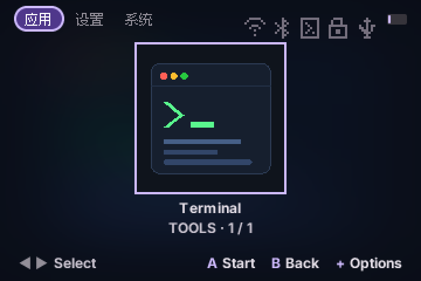
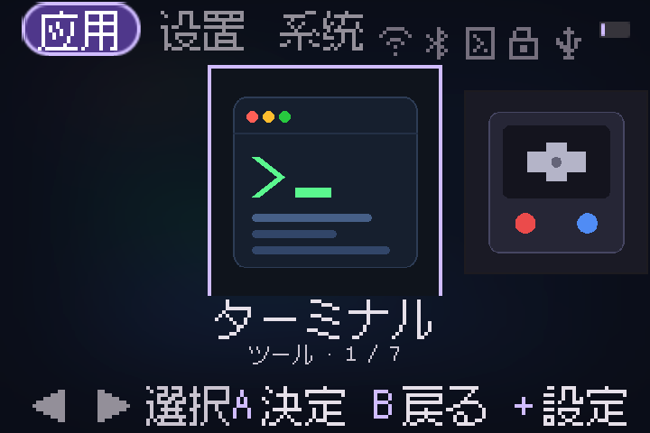

# CPR-163 — bitmap font scaling evidence

The package uses a 360×240 logical canvas with integer 2× presentation on the
720×480 panel. Text classes use logical pixels, so 24px logical text appears as
48px on the panel.

## Before correction — device capture

Captured from `/dev/fb0` before the font-class rescale was corrected. The
navigation, title and footer retained 24px logical classes and doubled on the
panel.

## After correction — desktop renderer

Built from the updated PocketShell source with the Linux desktop renderer. The
renderer window is 360×240; this image is nearest-neighbour scaled to 720×480
to show the exact 2× presentation. This screenshot is from the simulator, not a
new capture from the handheld.

## Supporting captures from the earlier review

### Library render fixture

### 1:1 text crop

The crop shows the doubled pixel blocks before the font correction.

## Remaining visual coverage

The updated screenshot covers the launcher home screen. Settings and system
pages still need fresh captures, and the corrected package has not been flashed
to the handheld.
