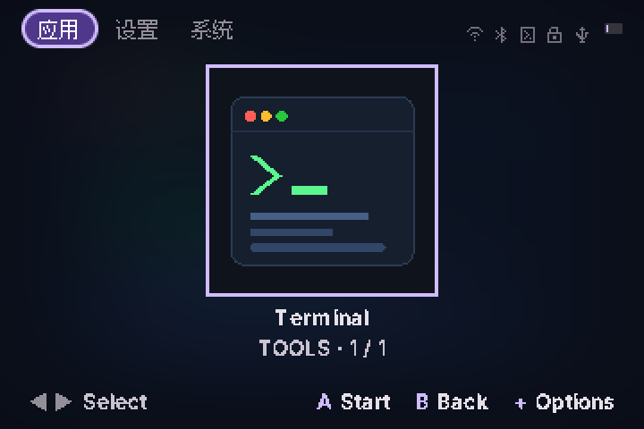

# CPR-163 — bitmap font and icon scaling evidence

The package uses a 360×240 logical canvas with integer 2× presentation on the
720×480 panel. Text classes and icons use logical pixels, so anything authored
for the old 720-wide layout must be halved.

## Final desktop renderer capture

Built from the current source with the Linux desktop renderer. The window is
360×240; this image is nearest-neighbour scaled to 720×480 to show the exact 2×
presentation. Text is a hard 1-bit atlas (no gray antialiasing), and the status
icons render at 9px logical / 18px panel, matching the 12px logical body text.

### Status bar close-up

Top 32 logical pixels, scaled 2×.

## What changed

- **Font coverage is thresholded to 1-bit.** The compiler's 9×3 supersampling
  produced 0–255 gray coverage; magnified 2× that read as blurry Latin text.
  `scripts/patch-pocketjs-bitmap-font.py` thresholds each cell at 128.
- **Status icons are 9px logical again.** They carried `scale={2}` from the
  720-wide layout, so they rendered 18px logical / 36px panel — 50% taller than
  the body text.
- **Battery gauge halved** from 17×9 to 10×6 logical pixels to sit in the same
  weight class as the icons.

## Earlier stage captures

### Before the font-class correction

Device framebuffer capture before the font classes were rescaled.

### After the font-class correction, before 1-bit coverage

Same desktop renderer with corrected font classes, still using the compiler's
antialiased coverage.

### Library render fixture

### 1:1 text crop from the pre-fix build

## Still open

- Settings and system pages have not been re-captured.
- The corrected package has not been flashed to the handheld; these captures are
  from the Linux desktop renderer, not `/dev/fb0`.
